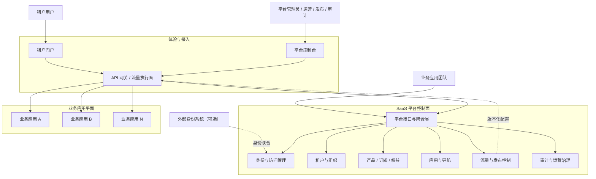
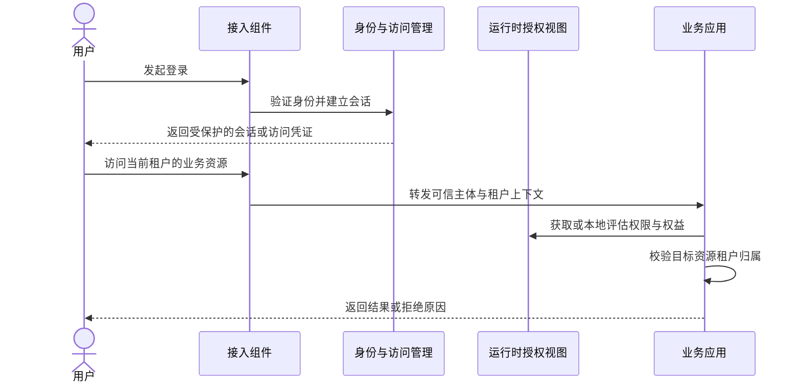
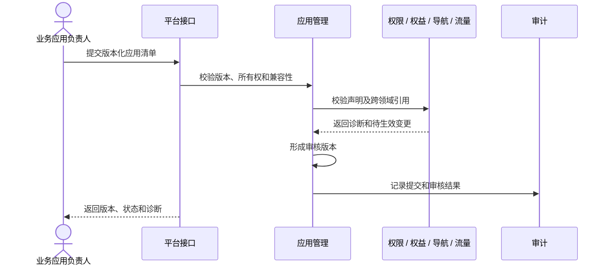
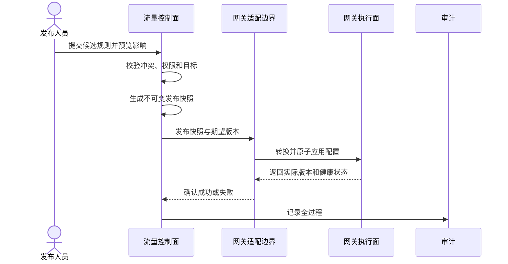

# SaaS Platform Architecture

| 属性 | 内容 |
| --- | --- |
| 文档状态 | 草案，待架构评审 |
| 版本 | 0.2 |
| 架构定位 | SaaS Platform Control Plane |
| 设计容量 | 10,000 个活跃租户、1,000,000 个注册用户 |
| 技术策略 | 逻辑架构技术中立，具体选型由 ADR 决定 |

本文描述 SaaS Platform 的边界、领域、交互、规模策略和架构不变量。详细需求见[用户需求](docs/requirements/user-requirements.md)、[系统需求](docs/requirements/system-requirements.md)和[术语表](docs/requirements/glossary.md)。

## 1. 架构驱动因素

### 1.1 业务驱动

- 多个业务应用共享统一的平台能力和租户运营体验。
- 业务应用独立拥有业务规则、数据和发布节奏。
- 权限、权益、导航和流量规则由不同领域负责，结果可解释。
- 新应用通过稳定契约接入，不要求修改平台核心代码。

### 1.2 规模驱动

- 至少支持 10,000 个活跃租户和 1,000,000 个注册用户。
- 支持用户加入多个租户以及大规模成员、会话和授权关系。
- 支持租户负载高度不均，限制噪声邻居对共享资源的影响。
- 支持横向扩展、数据分区、批量处理和派生读模型。
- 业务请求热路径不依赖控制面逐请求同步查询。

### 1.3 质量驱动

- 租户隔离独立于身份验证和功能授权，默认拒绝跨租户访问。
- 高风险撤销快速生效，普通配置变更在有界时间内传播。
- 控制面短时故障不破坏网关执行面最后一份有效配置。
- 关键操作可审计，发布可回滚，权威数据可恢复。
- 架构不绑定尚未评审的供应商、产品或部署平台。

## 2. 系统边界



### 2.1 控制面

控制面提供开通、管理、运营和治理多租户环境所需的公共能力。它保存平台权威配置，计算授权、权益和发布结果，并向运行时消费方分发有版本的派生数据。

### 2.2 接入执行面

接入执行面接收网络请求并执行协议处理、流量保护、路由匹配和请求转发。`API 网关` 在本文中是逻辑角色，不代表任何具体产品。

### 2.3 业务应用平面

业务应用平面承担具体业务功能、业务数据和业务侧租户隔离。平台提供的身份或授权上下文不能替代业务应用对目标资源租户归属的检查。

## 3. 架构原则

### 3.1 领域边界与部署边界分离

逻辑领域先按业务语义划分，物理服务再根据容量、可用性、数据一致性和团队所有权决定。一个领域可以独立部署，多个领域也可以暂时共同部署；任何部署方式都不能破坏数据所有权和公开契约。

当前不预先决定模块化单体、微服务数量或进程拓扑。

### 3.2 权威写模型与派生读模型分离

身份、租户、订阅、应用和流量配置各自拥有权威事实。面向高频读取的授权、权益、导航和流量配置可以形成可重建的派生视图。

```text
权威状态变更
  → 原子提交及版本记录
  → 可靠变更通知
  → 消费方去重、排序和更新派生视图
  → 在传播 SLO 内对运行时生效
```

缓存和派生视图不能成为唯一事实来源，必须可通过版本检测漂移并从权威数据重建。

### 3.3 运行时热路径自治

业务访问不能在每次请求中串行调用租户、订阅、导航和流量控制模块。高频判断使用可验证凭证、局部策略、版本化读模型或安全缓存；控制面负责更新和撤销传播。

该原则避免控制面故障放大为所有业务应用故障。

### 3.4 租户隔离是独立控制

每次资源访问都需要分别回答：

1. 主体是谁，身份是否可信。
2. 当前租户是谁，成员关系是否有效。
3. 主体是否有权执行该操作。
4. 租户是否拥有该能力或额度。
5. 目标资源是否确实属于当前租户或允许的隔离域。

前四项通过仍不能省略第五项。认证和授权成功不等于完成租户隔离。

### 3.5 技术中立与可替换适配

领域模型只表达业务语义。身份协议、数据库、缓存、事件传输、网关、计算平台和交付工具通过端口与适配器隔离。

具体技术只有在以下条件满足后才能成为项目基线：

- 已明确功能与非功能约束。
- 至少比较可行备选方案。
- 对关键规模和故障场景完成验证。
- 通过 ADR 记录选择、代价和退出策略。

## 4. 逻辑领域

| 领域 | 主要职责 | 不负责 |
| --- | --- | --- |
| 身份与访问管理 | 身份、认证、会话、角色、权限、策略和服务身份 | 套餐、权益、导航内容、业务数据 |
| 租户与组织 | 租户生命周期、成员、组织、标签和隔离策略 | 身份凭证、订阅计费、业务资源 |
| 产品与订阅 | 产品、功能、套餐版本、订阅状态和生效周期 | 具体业务授权判断、支付和财务账单 |
| 权益与配额 | 权益定义、租户授权、覆盖、用量与最终额度 | 用户角色、页面导航、业务计费 |
| 应用管理 | 应用标识、版本、清单、状态和租户开通范围 | 业务实现和业务数据 |
| 导航管理 | 应用入口、页面导航、排序和可见性解释 | 后端安全授权、网络流量转发 |
| 流量与发布控制 | 流量规则、灰度、不可变发布、分发和回滚 | 运行时转发实现、业务处理 |
| 审计与运营治理 | 审计契约、安全事件、租户级运营和合规留存 | 普通调试日志和业务分析仓库 |

`platform/iam` 使用 [NIST IAM Glossary](https://csrc.nist.gov/glossary/term/Identity_and_access_management) 收录的缩写 IAM；文档首次出现时必须写作“身份与访问管理（Identity and Access Management，IAM）”。

### 4.1 权限、权益、策略和导航

| 概念 | 归属 | 回答的问题 |
| --- | --- | --- |
| Permission | 身份与访问管理 | 当前主体是否被授予某种操作能力？ |
| Policy | 身份与访问管理 / 业务应用 | 在主体、资源和环境条件下是否允许操作？ |
| Entitlement | 权益与配额 | 当前租户是否开通该功能或额度？ |
| Navigation | 导航管理 | 当前界面应展示哪些应用和页面入口？ |
| Tenant Isolation | 租户与业务数据边界 | 目标资源是否属于当前租户可访问范围？ |

```text
允许业务操作
= 身份有效
AND 成员关系有效
AND 权限与策略允许
AND 租户权益允许
AND 资源租户隔离检查通过
```

## 5. 核心交互

### 5.1 登录与业务访问



访问凭证只携带稳定、必要且可控大小的声明。易变化或数量巨大的权限、权益和菜单通过有版本的运行时视图提供。

### 5.2 应用接入



跨领域工作流由应用层协调，各领域只修改自身状态，不直接写入其他领域存储。

### 5.3 流量发布



发布失败时执行面继续使用上一有效版本。回滚是把历史快照重新发布为新的发布记录，而不是修改历史。

## 6. 大规模设计

### 6.1 水平扩展

- 对外请求处理组件保持无本地唯一状态，可增加实例分担负载。
- 会话、授权、权益和导航状态通过可共享或可复制的权威状态与派生视图提供。
- 定时任务、事件消费和批处理使用分区所有权或租约，避免重复全量工作。
- 全局唯一约束与租户内唯一约束分开设计，减少不必要的全局协调。

### 6.2 数据分区

- 租户拥有的数据从第一版起携带稳定租户或隔离域键。
- 查询和索引优先以租户边界、稳定游标和时间范围组织。
- 避免依赖跨全部租户的同步事务、全局锁和高频全量聚合。
- 数据层允许未来按租户哈希、租户等级、地域或独占单元迁移。
- 大租户迁移和重新分区必须可在线执行、可验证和可回退。

### 6.3 租户公平性

- 在入口、应用、任务、事件和存储层建立租户级使用量视图。
- 为交互请求和批处理设置不同资源池、优先级或并发预算。
- 支持按租户限流、配额、背压和隔离，避免无界重试放大故障。
- 最大租户、突发租户和恶意租户必须进入容量与混沌测试模型。

### 6.4 高基数治理

百万用户和万租户会产生高基数标签。遥测系统不能无条件把用户、会话和全部租户标识作为常驻指标标签；应使用分层聚合、受控租户标签、日志/追踪关联和按需诊断。

## 7. 可靠性与一致性

| 状态类型 | 一致性优先级 | 传播策略 |
| --- | --- | --- |
| 身份停用、会话撤销、权限撤销 | 安全优先 | 快速失效，超时后拒绝或进入安全降级 |
| 租户状态、订阅、权益 | 正确性优先 | 版本化通知，有界最终一致，可重建 |
| 应用和导航配置 | 体验一致 | 版本化派生视图，有界缓存失效 |
| 流量规则 | 原子发布 | 完整不可变快照，确认后切换 |
| 审计记录 | 不丢失、只追加 | 本地可靠记录后异步汇聚 |

跨领域流程通过状态机、幂等命令和可靠事件协调。消费者记录处理版本，能够处理重复、乱序、暂时不可用和重放。

## 8. 安全架构

### 8.1 信任边界

1. 客户端到接入组件是外部不可信边界。
2. 接入组件到平台和业务应用是受控服务边界。
3. 平台跨租户管理接口是高权限边界。
4. 流量适配组件到网关管理接口是高权限发布边界。
5. 外部身份、通知和计量系统都是外部依赖边界。

### 8.2 安全不变量

- 不信任客户端自行提交的租户标识、角色或权限。
- 所有管理写入和跨租户操作显式授权并审计。
- 权限默认拒绝，租户隔离默认收窄，敏感动作支持强化认证。
- 外部同名身份头必须被接入层移除；服务仅信任可验证来源。
- 密码、完整访问凭证、密钥和敏感个人信息不进入日志。
- 安全协议遵循当前稳定规范与安全最佳实践。

## 9. 部署与技术选型边界

逻辑架构允许以下领域按实际证据共同部署或独立扩展：

- 身份验证和会话具有突发性与高安全要求，可独立扩展。
- 授权与权益读取属于高频运行时能力，需要低延迟派生视图。
- 订阅与应用管理以正确性和审计为主，写入频率相对较低。
- 审计写入量大且保留周期长，需要与事务查询隔离。
- 流量配置发布频率低，但错误影响面大，需要独立权限和回滚边界。

以下选择保持开放：

- 编程语言、Web 框架和前端框架。
- 关系型、文档型或其他权威存储及分区方式。
- 缓存、事件传输、任务调度和搜索能力。
- API 网关、服务网络和配置分发实现。
- 计算平台、部署包格式、秘密管理和可观测性产品。

选型不能仅以“常用”或早期示例为依据，必须用需求中的容量、延迟、可用性、安全和运维约束评估。

## 10. 仓库映射

```text
saas-platform/
├── platform/        # 平台领域与应用逻辑
├── applications/    # 接入平台的业务应用
├── services/        # 可部署入口与基础设施适配
├── frontend/        # 平台用户体验
├── api/             # 公开接口、事件和清单契约
├── sdk/             # 业务应用接入能力
├── deploy/          # 产品中立的部署与环境定义
├── tests/           # 跨模块、容量、安全和端到端验证
└── docs/            # 需求、架构、标准和历史决策
```

详细职责见[项目结构与模块边界](docs/architecture/project-structure.md)。

## 11. 架构演进门槛

领域拆分、数据分区和独占租户单元由证据驱动：

- 某领域需要独立扩缩容或更高可用性等级。
- 数据量、热点或合规要求需要独立存储和隔离。
- 发布频率、故障域或团队所有权已经形成稳定边界。
- 容量测试证明当前部署方式不能满足目标。

拆分前必须具备稳定接口、数据所有权、可回放状态传播和迁移方案。拆分本身不能成为解决边界混乱的替代品。

## 12. 待决策事项

| 主题 | 决策前必须回答的问题 |
| --- | --- |
| 身份 | 身份源、联合协议、会话形式、强化认证和撤销传播如何满足安全目标？ |
| 授权 | 本地评估与远程决策如何组合，策略复杂度和传播时间是多少？ |
| 数据隔离 | 哪些领域共享、独占或混合，如何在线迁移大租户？ |
| 权威存储 | 一致性、分区、索引、备份和恢复如何满足容量与 RPO/RTO？ |
| 状态传播 | 顺序、重放、去重、积压和灾难恢复如何实现？ |
| 网关执行面 | 候选产品如何支持原子发布、回滚、灰度、规模和供应商退出？ |
| 部署平台 | 如何支持横向扩展、故障隔离、秘密管理和渐进发布？ |
| 可观测性 | 如何在高基数租户环境中平衡诊断能力、成本和隐私？ |

## 13. 规范参考

架构采用的安全、可靠性、多租户隔离和 SaaS 工程依据，以及它们与需求编号的映射，统一维护在[安全、可靠性与多租户规范依据](docs/requirements/standards-and-evidence.md)。这些参考不构成供应商产品选型或合规认证。
