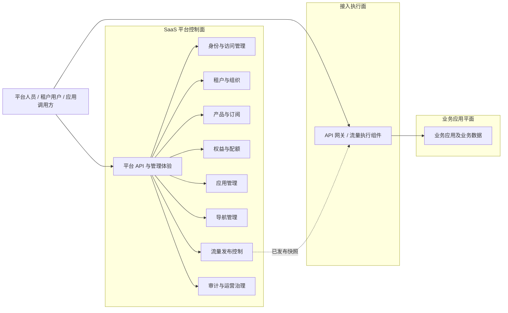

# SaaS Platform 系统需求

| 属性 | 内容 |
| --- | --- |
| 文档状态 | 草案，待系统需求评审 |
| 版本 | 0.3 |
| 需求来源 | [用户需求](user-requirements.md) |
| 架构定位 | 技术中立的 SaaS 控制面 |
| 设计容量 | 10,000 个活跃租户、1,000,000 个注册用户 |
| 模块功能需求 | [模块需求地图](modules/README.md) |
| 追踪关系 | [需求追踪矩阵](traceability.md) |

## 1. 文档职责

本文定义系统边界、跨模块行为、数据与一致性规则、平台接口和非功能需求。各领域的详细功能系统需求、状态、不变量和验收场景维护在[模块需求](modules/README.md)。

需求分工如下：

| 内容 | 权威位置 |
| --- | --- |
| 产品目标、角色、旅程和范围 | [用户需求](user-requirements.md) |
| 领域用户需求与功能系统需求 | [模块需求](modules/README.md) |
| 跨模块接口、数据规则和非功能需求 | 本文 |
| 外部规范及需求映射 | [规范依据矩阵](standards-and-evidence.md) |
| 用户需求到系统需求和验收场景 | [需求追踪矩阵](traceability.md) |

## 2. 系统边界

平台控制面负责租户环境的开通、身份、授权、商业化能力、应用接入、流量配置和治理。业务应用平面负责实际业务功能和业务数据；接入执行面负责接收、保护和转发网络请求。



### 2.1 平台负责

- 全局用户、服务身份、凭据、会话和租户成员关系。
- 角色、权限、策略和统一授权语义。
- 租户生命周期、组织、标签和隔离上下文。
- 产品、套餐版本、订阅、权益和资源配额。
- 应用元数据、版本化清单、审核和租户开通。
- 页面导航配置及最终可见性计算。
- 网络流量规则、灰度、不可变发布快照和执行面分发。
- 平台审计、安全事件、租户级指标和管理接口。

### 2.2 业务应用负责

- 业务实体、业务规则、业务接口、业务数据和业务侧租户隔离。
- 通过版本化应用清单声明权限、权益、导航、接口、流量和审计能力。
- 验证可信身份与租户上下文，并在每次资源访问时执行授权和隔离。
- 根据平台权益契约执行功能和配额限制，不依赖套餐名称。
- 按平台契约报告审计事件、用量和运行指标。

### 2.3 接入执行面负责

- 执行请求接收、协议处理、流量保护和网络转发。
- 使用已确认、完整且本地可用的流量配置处理业务请求。
- 移除或覆盖来自外部的不可信身份、租户和路由控制头。
- 报告实际配置版本、健康状态和发布确认。

### 2.4 当前系统不包含

- 具体 API 网关、数据库、缓存、消息系统和部署平台产品。
- 业务应用的领域模型、业务流程和业务页面。
- 支付、税务、开票、财务账单和对账。
- 未经业务、法规和恢复目标确认的跨地域多活。

## 3. 全局架构约束

1. 需求与逻辑架构不得绑定具体供应商或产品；技术选择必须通过 ADR。
2. 领域边界与部署边界分离，不预先规定模块化单体、微服务数量或进程拓扑。
3. 每个领域拥有明确的数据所有权，禁止跨领域直接读取或修改存储结构。
4. 对外 API、事件、应用清单和 SDK 必须版本化并定义兼容、弃用和迁移策略。
5. Permission、Entitlement、Navigation 和 Routing 是独立概念，不能相互替代。
6. 导航隐藏不是安全控制；业务接口必须独立授权并验证目标资源租户归属。
7. 业务请求热路径不得逐请求同步依赖控制面管理查询。
8. 运行时组件必须可横向扩展、可分区演进并支持租户级资源治理。
9. 写操作必须可幂等处理；跨边界状态传播必须可重试、可去重、可重放和可观测。
10. 任何缓存或派生视图都必须定义权威来源、版本、失效条件、重建方式和最大陈旧时间。
11. 高风险收窄变化优先安全一致性；普通体验变化可以采用有界最终一致。
12. 控制面故障不得破坏执行面已经确认的上一有效配置。

## 4. 模块功能需求地图

| 模块 | 功能需求编号 | 数据所有权 | 详细文档 |
| --- | --- | --- | --- |
| 身份与访问管理 | `SR-IAM-*` | 身份、凭据、会话、角色、权限和绑定 | [IAM](modules/iam.md) |
| 租户、组织与隔离 | `SR-TEN-*` | 租户、成员、组织、标签和隔离策略 | [Tenant](modules/tenant.md) |
| 产品与订阅 | `SR-SUB-001`、`SR-SUB-002`、`SR-SUB-007` | 产品、套餐版本和订阅事实 | [Subscription](modules/subscription.md) |
| 权益与配额 | `SR-SUB-003` 至 `SR-SUB-006`、`SR-SUB-008` | 权益定义、覆盖、配额和用量语义 | [Entitlement](modules/entitlement.md) |
| 应用管理 | `SR-APP-*` | 应用、版本、清单、审核和租户开通 | [Application](modules/application.md) |
| 导航管理 | `SR-NAV-*` | 导航节点、租户定制和派生视图 | [Navigation](modules/navigation.md) |
| 流量发布控制 | `SR-ROUTE-*` | 规则、候选、快照和发布记录 | [Routing](modules/routing.md) |
| 审计与运营治理 | `SR-AUD-*` | 审计事件、完整性和留存策略 | [Audit](modules/audit.md) |

## 5. 平台接口与跨模块能力

| 编号 | 优先级 | 系统需求 | 主要来源 | 验证重点 |
| --- | --- | --- | --- | --- |
| SR-API-001 | P0 | 系统应提供版本化的管理接口、运行时读取接口和事件契约。 | `UR-APP-001`、`UR-APP-004`、`UR-AUD-003` | 版本可识别，破坏性变化不能静默覆盖旧契约。 |
| SR-API-002 | P0 | 接口应采用统一错误、分页、排序、过滤、时间和并发控制约定。 | `UR-TEN-002`、`UR-SUB-002`、`UR-AUD-001` | 各模块错误与列表行为一致，游标稳定且有界。 |
| SR-API-003 | P0 | 创建、变更、发布和回滚操作必须支持幂等键或等效去重。 | `UR-TEN-001`、`UR-SUB-002`、`UR-SUB-004`、`UR-APP-005`、`UR-ROUTE-003` | 超时重试不重复创建、扣减或发布。 |
| SR-API-004 | P0 | 所有跨边界调用必须传播追踪标识和业务关联标识。 | `UR-AUD-002` | 同步请求、异步任务、事件和外部发布可关联。 |
| SR-API-005 | P0 | 系统应提供聚合当前身份、租户、应用、权益和导航的启动视图。 | `UR-IAM-002`、`UR-TEN-006`、`UR-SUB-006`、`UR-NAV-001` | 结果声明各部分版本，不以聚合缓存替代权威模块。 |
| SR-API-006 | P0 | 批量接口必须定义单批上限、逐项结果、部分失败和重试行为。 | `UR-IAM-006`、`UR-TEN-002`、`UR-OPS-001` | 单项失败不产生未知整体状态，重试不会重复副作用。 |
| SR-API-007 | P1 | 长耗时操作应采用异步任务语义，并提供状态、进度、结果、失败、取消或补偿能力。 | `UR-TEN-001`、`UR-SUB-002`、`UR-APP-005`、`UR-ROUTE-003`、`UR-AUD-001` | 客户端可安全轮询或接收通知，任务有到期和幂等规则。 |

### 5.1 管理接口

- 面向平台人员和租户管理员，执行配置、生命周期和查询操作。
- 所有写操作显式授权；跨租户管理使用独立权限、目标租户和理由。
- 使用乐观并发控制或等效机制防止静默覆盖他人变更。
- 高影响变更提供预览、审核或确认机制，并记录前后版本。

### 5.2 运行时接口

- 面向业务应用和平台前端，优先提供低延迟、只读、批量和可缓存视图。
- 返回权威对象版本或派生结果版本，使消费方可以检测变化和陈旧状态。
- 失败策略必须区分安全收窄、使用上一有效状态和显式不可用，不能统一“失败放行”。
- 不把完整权限、权益和导航集合长期复制进无法及时撤销的访问凭证。

### 5.3 事件契约

- 每个事件包含事件标识、类型、Schema 版本、聚合标识、聚合版本、发生时间和关联标识。
- 事件只描述已经发生的领域事实，不要求消费者修改其他领域权威数据来伪造原事件。
- 消费方处理重复、乱序、延迟和重放，并能检测聚合版本缺口。
- Schema 增加字段必须遵循兼容规则；删除、重命名和语义改变需要新主版本及迁移计划。

## 6. 数据与一致性要求

### 6.1 标识与租户归属

- 每个核心对象必须拥有稳定、全局不可混淆且不复用的内部标识。
- 外部代码、显示名称、邮箱、路径等可变标识不能替代内部标识。
- 租户拥有数据必须显式绑定租户或隔离域；平台全局数据必须明确标记为全局作用域。
- 当前租户只能来自已验证身份上下文或受信任服务上下文，不能信任客户端任意字段。
- 平台跨租户操作必须携带操作者权限、显式目标租户、业务理由和审计关联。

### 6.2 数据访问与查询

- 数据访问层默认施加租户范围，不能依赖每个调用方手工拼接过滤条件。
- 列表、搜索、导出和批处理必须分页、分片或异步执行，禁止无界全量扫描。
- 分页使用稳定排序和游标；相同时间对象使用稳定标识解决顺序冲突。
- 时间使用统一时基保存，接口使用带时区格式并明确生效区间边界。
- 权限、权益、应用、事件和其他公开代码不能无迁移方案地重命名或复用。

### 6.3 数据所有权

- 一个领域对象只有一个权威写入模块。
- 跨模块读取通过公开应用接口、版本化事件或可重建派生视图进行。
- 聚合视图保留来源版本，不能成为修改源领域的反向入口。
- 数据修正通过拥有模块执行并产生新事实，不允许直接修改其他模块存储。
- 模块拆分、合并或迁移必须保持标识、版本和公开语义稳定。

### 6.4 一致性与传播分类

| 状态类型 | 一致性重点 | 最大陈旧与失败原则 |
| --- | --- | --- |
| 身份停用、会话撤销、权限撤销 | 安全优先 | 满足 `NFR-PERF-006`；超过窗口时拒绝高风险访问 |
| 租户暂停和隔离收窄 | 安全与租户边界优先 | 版本化快速传播；未知状态默认拒绝 |
| 订阅、权益和应用状态 | 正确性优先 | 有界最终一致；消费方检测版本缺口并重建 |
| 导航配置 | 体验一致 | 可缓存；权限或权益收窄优先失效 |
| 流量规则 | 原子快照与上一有效状态 | 完整快照确认后切换；失败保留上一版本 |
| 审计记录 | 不丢失、只追加 | 可靠记录后异步汇聚；高风险写入定义降级策略 |

### 6.5 可靠状态传播

- 领域写入与待发布事实在本地原子边界内保持一致，不依赖跨系统长事务。
- 发布方重试不产生不同逻辑事实；消费者按事件标识和聚合版本去重。
- 消费者记录处理位置和对象版本，支持暂停、重放、快照恢复和毒性消息隔离。
- 事件积压、版本缺口、重试次数和传播延迟必须可观测。
- 派生视图可从权威数据和事件重建，并能够比较期望版本和实际版本。

## 7. 可信访问上下文与集成要求

业务应用获得的最小可信上下文应表达：

```json
{
  "subject_id": "user-or-service-id",
  "subject_type": "user",
  "tenant_id": "tenant-id",
  "session_id": "session-id",
  "auth_time": "timestamp",
  "assurance": "policy-defined-level",
  "context_version": "opaque-version"
}
```

该示例只描述语义，不规定 Token、Cookie、证书或其他凭证格式。

### 7.1 上下文规则

- 接入层移除外部请求中的同名身份、角色和租户控制头，再写入可验证上下文。
- 业务应用验证上下文来源、完整性、有效期、目标受众和当前租户。
- 角色、完整权限、菜单和大量权益不默认复制到长生命周期凭证。
- 上下文验证成功不代表业务授权成功；业务应用仍需判断权限、权益和资源归属。

### 7.2 外部依赖

- 所有外部调用设置连接、请求和整体超时，并使用有限重试与退避。
- 只有幂等或具备幂等键的操作允许自动重试。
- 外部依赖失败必须有明确降级、隔离或人工恢复策略。
- 外部返回的主体、租户、订单、用量和执行状态必须验证来源、版本和关联关系。

### 7.3 开放标准

- 身份验证、身份联合、生命周期同步、API 描述、事件 Schema 和遥测优先采用开放且仍受维护的标准。
- 具体协议、版本、强制配置、兼容范围和退出方案必须通过 ADR 与契约确认。
- 已选安全协议必须遵循对应稳定规范和安全最佳实践，不得继续启用已明确不安全的流程。

## 8. 非功能需求

以下目标是内部设计与验证基线，不是对外 SLA。正式承诺前必须定义 SLI 公式、统计窗口、排除规则、数据来源和错误预算。

完整外部依据见[规范依据矩阵](standards-and-evidence.md)。

### 8.1 容量与伸缩

| 编号 | 设计基线 | 验证方式 |
| --- | --- | --- |
| NFR-CAP-001 | 支持至少 10,000 个活跃租户；租户增长不要求修改代码或逐租户手工部署。 | 租户开通、列表、状态传播和批量操作容量测试 |
| NFR-CAP-002 | 支持至少 1,000,000 个注册用户，并允许用户加入多个租户。 | 身份查询、登录索引和多租户用户场景测试 |
| NFR-CAP-003 | 数据模型和容量测试覆盖至少 5,000,000 条租户成员关系。 | 成员写入、分页、授权和撤销传播测试 |
| NFR-CAP-004 | 会话与撤销机制覆盖至少 1,000,000 个同时有效会话。 | 会话建立、读取、过期、批量撤销和恢复测试 |
| NFR-CAP-005 | 平台运行时组件可横向扩展，不依赖单进程内存中的唯一状态。 | 多实例扩缩容、实例故障和状态一致性验证 |
| NFR-CAP-006 | 列表、导出、审计和批处理不得无界全量扫描。 | 大数据量查询计划、分页和异步任务测试 |
| NFR-CAP-007 | 按租户实施配额、限流、公平性或隔离，防止单租户形成噪声邻居。 | 大租户、突发租户和恶意租户混合负载测试 |
| NFR-CAP-008 | 数据分区包含稳定租户或等效隔离维度，并允许后续水平分区。 | 分区路由、热点、迁移和回退原型验证 |

峰值并发和吞吐不能由用户总量直接推导。容量验证前必须建立登录、授权、权益、导航、管理写入、事件、审计和发布的独立负载模型。

### 8.2 性能与传播目标

| 编号 | 内部目标 | 测量边界 |
| --- | --- | --- |
| NFR-PERF-001 | 基准负载下，远程授权与权益读取 p95 ≤ 100 ms、p99 ≤ 250 ms。 | 平台接收请求至返回完整决策，不含调用方网络 |
| NFR-PERF-002 | 聚合启动视图与导航读取 p95 ≤ 200 ms、p99 ≤ 500 ms。 | 平台 API 边界，分别记录冷缓存与热缓存 |
| NFR-PERF-003 | 管理读取 p95 ≤ 300 ms；不含异步外部动作的管理写入 p95 ≤ 500 ms。 | 受控数据规模和并发下的平台 API 边界 |
| NFR-PERF-004 | 本地策略或缓存命中的授权判断 p95 ≤ 20 ms。 | 业务进程内或同机运行时组件边界 |
| NFR-PERF-005 | 用户登录 p95 ≤ 1 秒，不包含外部身份提供方响应时间。 | 平台发起验证至本地会话建立完成 |
| NFR-PERF-006 | 99% 的高风险停用、撤权在 10 秒内对运行时生效。 | 权威提交成功至所有目标运行时拒绝旧访问 |
| NFR-PERF-007 | 99% 的普通权益、导航和应用状态变化在 60 秒内传播完成。 | 权威提交成功至目标派生视图达到期望版本 |
| NFR-PERF-008 | 99% 的已确认流量配置在 60 秒内被目标执行面确认。 | 发布开始至所有目标返回匹配版本和摘要 |

所有延迟测试必须注明请求类别、负载、数据规模、缓存状态、依赖状态、统计窗口和样本量。

### 8.3 可用性与恢复

| 编号 | 内部目标 | 验证方式 |
| --- | --- | --- |
| NFR-AVL-001 | 身份验证、运行时授权、权益和启动视图月度可用性目标 ≥ 99.95%。 | 基于用户成功标准的 SLI 和故障注入 |
| NFR-AVL-002 | 管理与配置写入接口月度可用性目标 ≥ 99.9%。 | 管理 API SLI、依赖故障和任务恢复验证 |
| NFR-AVL-003 | 控制面故障不得使执行面丢失最后一份有效流量配置。 | 控制面断连、重启和执行面持续流量测试 |
| NFR-AVL-004 | 生产关键路径不得依赖单一实例；组件故障应自动隔离或转移。 | 实例、节点和可用区级故障演练 |
| NFR-AVL-005 | 身份、租户、订阅和发布配置目标 RPO ≤ 5 分钟、RTO ≤ 30 分钟。 | 备份恢复和时间点恢复演练 |
| NFR-AVL-006 | 外部依赖必须有超时、有限重试、退避、熔断或等效降级策略。 | 延迟、失败、限流和错误响应注入 |
| NFR-AVL-007 | 备份恢复、执行面回滚和关键依赖故障必须定期演练并记录结果。 | 周期性演练记录、问题整改和复测证据 |

### 8.4 安全与隐私

| 编号 | 要求 | 验证方式 |
| --- | --- | --- |
| NFR-SEC-001 | 身份验证采用风险分级方法，并参考 NIST SP 800-63-4。 | 身份威胁模型、认证策略和安全测试 |
| NFR-SEC-002 | Web 与 API 安全验证目标至少对齐 OWASP ASVS 5.0 Level 2，偏差必须记录。 | 带版本控制映射的安全测试和偏差评审 |
| NFR-SEC-003 | 所有外部生产通信加密；敏感内部通信具备双方服务身份或等效保护。 | 配置扫描、握手验证和服务身份测试 |
| NFR-SEC-004 | 密码、密钥和访问凭据不得明文存储或进入仓库、日志和错误响应。 | 秘密扫描、日志测试和存储设计评审 |
| NFR-SEC-005 | 授权默认拒绝并遵循最小权限；租户隔离独立于认证和角色授权验证。 | 权限矩阵、跨租户负向测试和资源归属测试 |
| NFR-SEC-006 | 管理写入、跨租户操作、权限提升和安全策略变更必须强化授权并审计。 | 高权限用例、职责分离和审计完整性测试 |
| NFR-SEC-007 | 接口实施输入验证、请求大小限制、滥用防护和敏感字段脱敏。 | 模糊测试、边界测试、限流和错误响应检查 |
| NFR-SEC-008 | 依赖与交付物进行来源校验、漏洞扫描并生成软件物料清单。 | CI 供应链检查、签名或摘要验证和 SBOM 校验 |
| NFR-SEC-009 | 系统支持数据分类、最小化收集、导出、保留和受控删除。 | 数据清单、生命周期测试和删除证明 |
| NFR-SEC-010 | 安全日志时间可靠同步，审计记录具备完整性保护。 | 时间偏移监控、篡改检测和恢复测试 |

### 8.5 可观测性与运营

- 为可用性、延迟、错误率、吞吐、正确性和传播延迟定义 SLI。
- 日志、指标和追踪包含服务、环境、版本和关联标识，以及受控租户维度。
- 监控登录失败、撤销、授权拒绝、跨租户拒绝、权益拒绝、发布失败、漂移和事件积压。
- 高基数租户、用户和会话维度采用分层聚合、受控标签或按需诊断。
- 审计、日志、指标和追踪使用不同的数据分类、访问和保留策略。
- 告警必须关联可操作处置步骤，避免只报告基础设施症状而不说明用户影响。

### 8.6 可维护性与可演进性

- 领域逻辑能在不依赖具体基础设施产品的情况下测试。
- 公开 API、事件、应用清单和 SDK 具有兼容规则、弃用窗口和迁移指南。
- 模块之间不得形成循环依赖，跨模块行为具有自动化架构检查。
- 新业务应用接入原则上不修改平台核心领域代码。
- 服务拆分、合并或替换基础设施不得改变已承诺领域语义。
- 关键技术选型、规模假设和不可逆决策记录为 ADR。
- 运行手册、故障模式、恢复步骤和责任人随实现一起维护。

## 9. 交付与运行要求

- 每个发布产物可追溯到产品版本、源代码提交、依赖清单、契约版本和内容摘要。
- 环境差异通过外部配置提供；敏感配置由专门的秘密管理能力提供。
- 发布支持健康检查、渐进发布、自动或人工回滚和完整变更审计。
- 数据结构变更版本化、可重复执行，并说明前向兼容、扩缩容和恢复策略。
- 交付流水线至少包含格式、静态分析、单元测试、契约测试、集成测试、安全扫描和产物校验。
- 生产拓扑、计算平台、网络方案和部署包格式由后续 ADR 决定。
- 紧急变更不能绕过追溯和事后审计；紧急权限有时间限制并在使用后复核。

## 10. 系统验收基线

1. 所有 P0 用户需求均映射到功能系统需求和验收场景。
2. 示例应用可通过版本化清单声明身份、权限、权益、导航、接口、流量和审计能力。
3. 多租户用户每次请求只有一个可信当前租户，跨租户访问测试全部拒绝。
4. 认证通过但资源租户不匹配的请求仍被拒绝。
5. 导航不可见之外，业务 API 独立执行权限、权益和资源租户归属检查。
6. 订阅变更、最终权益、应用状态和导航结果可以通过版本关联和解释。
7. 流量发布生成不可变快照；任一执行面发布失败不破坏上一有效版本。
8. 容量测试覆盖 10,000 个租户、1,000,000 个用户和定义的派生对象规模。
9. 单租户突发和异常负载不会使其他租户关键 SLO 失效。
10. 身份撤销、权益传播和流量发布满足规定传播时间。
11. 备份恢复、控制面故障、执行面回滚和关键依赖故障演练通过。
12. 安全验证、跨租户测试、依赖扫描和秘密扫描通过。
13. 运维手册覆盖发布、回滚、扩容、隔离、恢复和常见故障。

## 11. 需求质量与追踪规则

- 每个功能需求使用稳定 `SR-*` 编号，并至少映射一个用户需求或明确的架构、安全来源。
- 每个 P0 用户需求至少映射一个可执行 `AC-*` 验收场景。
- 验收场景描述前置状态、操作和可观察结果，不绑定尚未选择的框架或产品。
- 需求被替代时保留原编号、状态、原因和替代项；不得删除历史掩盖范围变化。
- 契约、ADR、测试和发布验收必须引用相关需求编号。
- 需求变化按“用户需求 → 系统需求 → 架构/ADR → 契约 → 测试”的顺序传播。

## 12. 规范参考

规范来源、类型、适用说明和需求编号映射统一维护在[安全、可靠性与多租户规范依据](standards-and-evidence.md)。这些引用用于支撑需求和验证，不表示项目已通过认证或选择了来源组织的产品。
