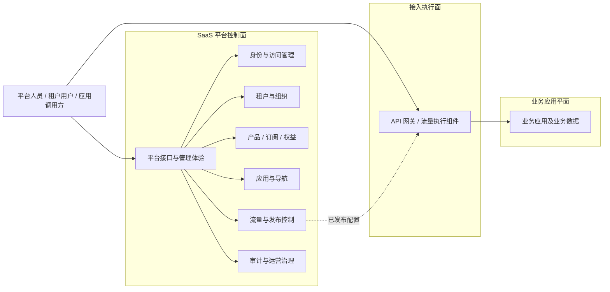

# SaaS Platform 系统需求

| 属性 | 内容 |
| --- | --- |
| 文档状态 | 草案，待系统需求评审 |
| 版本 | 0.2 |
| 需求来源 | [用户需求](user-requirements.md) |
| 架构定位 | 技术中立的 SaaS 控制面 |
| 设计容量 | 10,000 个活跃租户、1,000,000 个注册用户 |

## 1. 系统边界

平台控制面负责租户环境的开通、身份、授权、商业化能力、应用接入、流量配置和治理。业务应用平面负责实际业务功能和业务数据；接入执行面负责接收、保护和转发网络请求。



### 1.1 平台负责

- 全局用户身份、凭证、会话和租户成员关系。
- 角色、权限、策略和统一授权语义。
- 租户生命周期、组织结构、标签和隔离上下文。
- 产品、套餐版本、订阅、权益和资源配额。
- 应用元数据、接入清单、版本和租户开通范围。
- 页面导航配置及最终可见性计算。
- 网络流量规则、灰度策略、发布快照和执行面分发。
- 平台级审计、安全事件、租户级指标和管理接口。

### 1.2 业务应用负责

- 业务实体、业务规则、业务接口、业务数据和业务侧租户隔离。
- 声明应用所需权限、权益、导航、接口和流量需求。
- 验证可信身份与租户上下文，并在每次资源访问时执行授权和隔离。
- 按平台契约报告审计事件、用量和运行指标。

### 1.3 不属于当前系统的内容

- 具体 API 网关、数据库、缓存、消息系统和部署平台产品。
- 业务应用的领域模型和业务流程。
- 支付、税务、开票和财务账单处理。
- 未经评审确认的跨地域多活和特定云厂商能力。

## 2. 架构约束

1. 需求与逻辑架构不得绑定具体供应商或产品；选型必须通过 ADR。
2. 领域边界与部署边界分离，不预先规定单体、微服务或进程数量。
3. 每个领域拥有明确的数据所有权，禁止跨领域直接读写存储结构。
4. 对外接口、事件和应用清单必须版本化并定义兼容策略。
5. 业务应用依据权限、权益和策略判断能力，不依据套餐名称编写逻辑。
6. 导航隐藏不是安全控制；业务接口必须独立授权并校验租户隔离。
7. 业务请求热路径不得逐请求同步依赖控制面管理查询。
8. 运行时组件必须支持横向扩展、分区演进和租户级资源治理。
9. 写操作必须可幂等处理；跨边界状态传播必须可重试、可去重和可观测。
10. 任何缓存或派生视图都必须定义版本、失效和安全撤销传播时间。

## 3. 功能需求

### 3.1 身份与访问管理

身份与访问管理（Identity and Access Management，IAM）的术语来源见 [NIST IAM Glossary](https://csrc.nist.gov/glossary/term/Identity_and_access_management)。本项目用它统称身份生命周期、认证、会话和访问权限管理。

| 编号 | 系统需求 | 优先级 |
| --- | --- | --- |
| SR-IAM-001 | 系统应管理自然人、服务身份及其唯一标识，并区分身份主体类型。 | P0 |
| SR-IAM-002 | 系统应支持建立、续期、撤销和终止安全会话或等效访问凭证。 | P0 |
| SR-IAM-003 | 系统应管理角色、权限、角色权限关系和租户成员授权关系。 | P0 |
| SR-IAM-004 | 系统应支持应用注册命名空间隔离的权限定义，并检测冲突。 | P0 |
| SR-IAM-005 | 系统应提供一致的授权决策或可验证授权上下文。 | P0 |
| SR-IAM-006 | 系统应支持用户、凭证、会话、身份源和服务身份的停用与撤销。 | P0 |
| SR-IAM-007 | 系统应支持针对平台管理员和敏感操作的强化认证策略。 | P0 |
| SR-IAM-008 | 系统应提供基于开放标准的身份联合扩展点，首批协议由 ADR 确认。 | P1 |
| SR-IAM-009 | 系统应提供基于开放标准的用户生命周期同步扩展点。 | P1 |
| SR-IAM-010 | 访问凭证应遵循最小披露，不承载易膨胀或无法及时失效的完整权限与菜单集合。 | P0 |

### 3.2 租户、组织与隔离

| 编号 | 系统需求 | 优先级 |
| --- | --- | --- |
| SR-TEN-001 | 系统应管理租户稳定标识、状态、层级、标签和生命周期时间。 | P0 |
| SR-TEN-002 | 系统应支持一个用户加入多个租户，并在每个请求中确定唯一当前租户。 | P0 |
| SR-TEN-003 | 系统应管理租户成员状态、邀请、加入、退出和停用流程。 | P0 |
| SR-TEN-004 | 系统应支持可扩展的组织或部门结构，且组织不能跨越租户边界。 | P1 |
| SR-TEN-005 | 非正常状态租户的访问策略必须明确，默认拒绝业务访问。 | P0 |
| SR-TEN-006 | 所有租户资源访问必须同时验证主体权限和资源租户归属。 | P0 |
| SR-TEN-007 | 系统应支持共享、独占或混合隔离策略的抽象，不在本阶段绑定存储实现。 | P0 |
| SR-TEN-008 | 租户状态、标签和隔离策略变化必须产生版本化变更通知。 | P0 |

### 3.3 产品、套餐、订阅与权益

| 编号 | 系统需求 | 优先级 |
| --- | --- | --- |
| SR-SUB-001 | 系统应管理产品、功能、套餐和不可变套餐版本。 | P0 |
| SR-SUB-002 | 系统应管理租户订阅状态、起止时间、生效计划和变更原因。 | P0 |
| SR-SUB-003 | 权益至少应支持布尔能力、数值配额和受约束的枚举值。 | P0 |
| SR-SUB-004 | 系统应计算最终生效权益并返回值、来源、版本和有效期。 | P0 |
| SR-SUB-005 | 权益计算应支持套餐、租户覆盖和临时授权，并定义确定的优先级。 | P1 |
| SR-SUB-006 | 系统应支持配额上限、用量、预留量和超限策略的统一语义。 | P0 |
| SR-SUB-007 | 订阅和权益变更必须产生可重放、可去重的版本化通知。 | P0 |
| SR-SUB-008 | 系统应为高频权益判断提供批量读取和可安全缓存的派生视图。 | P0 |

### 3.4 应用管理

| 编号 | 系统需求 | 优先级 |
| --- | --- | --- |
| SR-APP-001 | 系统应管理应用稳定代码、名称、类型、所有者、状态和版本。 | P0 |
| SR-APP-002 | 系统应接收版本化应用清单，并校验格式、引用、命名空间和兼容性。 | P0 |
| SR-APP-003 | 应用清单应能声明身份接入、权限、权益、导航、接口、流量和审计能力。 | P0 |
| SR-APP-004 | 重复提交相同清单必须幂等，内容不同但版本相同必须拒绝。 | P0 |
| SR-APP-005 | 应用状态变化应一致影响租户开通、导航和后续流量发布。 | P0 |
| SR-APP-006 | 系统应记录清单版本、内容摘要、提交者、审核者和生效状态。 | P0 |
| SR-APP-007 | 系统应支持应用与平台契约的兼容矩阵。 | P1 |

### 3.5 导航管理

| 编号 | 系统需求 | 优先级 |
| --- | --- | --- |
| SR-NAV-001 | 系统应管理应用入口、导航节点、层级、排序、页面地址和展示元数据。 | P0 |
| SR-NAV-002 | 导航节点可关联权限、权益、应用状态和租户配置条件。 | P0 |
| SR-NAV-003 | 系统应计算当前主体和租户的最终导航，并返回稳定有序的树。 | P0 |
| SR-NAV-004 | 最终导航不得包含循环、孤立节点或不可访问父节点。 | P0 |
| SR-NAV-005 | 系统应支持预览结果并解释每个节点显示或隐藏的原因。 | P1 |
| SR-NAV-006 | 导航及其依赖状态变化必须在规定传播窗口内使派生结果失效。 | P0 |

### 3.6 流量路由与发布控制

| 编号 | 系统需求 | 优先级 |
| --- | --- | --- |
| SR-ROUTE-001 | 系统应以产品中立模型管理入口、匹配条件、目标服务、目标版本和流量策略。 | P0 |
| SR-ROUTE-002 | 系统应在发布前检查规则冲突、优先级歧义、无效目标和越权范围。 | P0 |
| SR-ROUTE-003 | 规则必须经过草稿、校验、审核和发布状态，执行面只消费已发布版本。 | P0 |
| SR-ROUTE-004 | 每次发布必须生成不可变版本、内容摘要、操作者和时间。 | P0 |
| SR-ROUTE-005 | 向任一网关执行面发布失败时，必须保留上一有效版本并返回可诊断结果。 | P0 |
| SR-ROUTE-006 | 系统应支持回滚到受支持的历史版本，回滚本身形成新发布记录。 | P0 |
| SR-ROUTE-007 | 系统应支持按租户、租户标签、显式名单和稳定规则进行灰度。 | P1 |
| SR-ROUTE-008 | 网关执行面不得逐请求同步查询路由控制面，应使用完整且有版本的本地可用配置。 | P0 |
| SR-ROUTE-009 | 网关产品差异必须封装在适配边界内，不得泄漏到领域模型和应用清单。 | P0 |

### 3.7 审计与运营治理

| 编号 | 系统需求 | 优先级 |
| --- | --- | --- |
| SR-AUD-001 | 系统应记录身份、授权、租户、订阅、应用和发布关键事件。 | P0 |
| SR-AUD-002 | 审计记录至少包含事件、时间、主体、租户、应用、动作、对象、结果和关联标识。 | P0 |
| SR-AUD-003 | 审计记录必须只追加，并能检测未授权修改或删除。 | P0 |
| SR-AUD-004 | 系统应按租户、主体、动作、对象、结果和时间范围检索审计记录。 | P0 |
| SR-AUD-005 | 系统应定义业务应用上报审计与用量事件的版本化契约。 | P1 |
| SR-AUD-006 | 运行指标、日志和追踪必须能够按租户分析，同时遵守隐私和基数限制。 | P0 |

### 3.8 平台接口与聚合能力

| 编号 | 系统需求 | 优先级 |
| --- | --- | --- |
| SR-API-001 | 系统应提供版本化的管理接口、运行时读取接口和事件契约。 | P0 |
| SR-API-002 | 接口应采用统一错误、分页、排序、过滤和并发控制约定。 | P0 |
| SR-API-003 | 创建、变更、发布和回滚操作必须支持幂等键或等效去重。 | P0 |
| SR-API-004 | 所有跨边界调用必须传播追踪标识和业务关联标识。 | P0 |
| SR-API-005 | 系统应提供聚合当前身份、租户、应用、权益和导航的启动视图。 | P0 |
| SR-API-006 | 批量接口必须定义单批上限、部分失败语义和重试行为。 | P0 |
| SR-API-007 | 长耗时操作应使用异步任务语义，并提供状态、取消或补偿能力。 | P1 |

## 4. 数据与一致性要求

### 4.1 核心对象

| 领域 | 核心对象 |
| --- | --- |
| 身份与访问 | User、ServiceIdentity、Credential、Session、Role、Permission、RoleBinding |
| 租户与组织 | Tenant、TenantMember、Organization、TenantLabel、IsolationPolicy |
| 产品与订阅 | Product、Feature、PlanVersion、Subscription、Entitlement、Usage |
| 应用 | Application、ApplicationVersion、ApplicationManifest、TenantApplication |
| 导航 | NavigationNode、TenantNavigationPreference |
| 流量发布 | TrafficRule、TrafficPolicy、ReleaseSnapshot、PublishRecord |
| 审计 | AuditEvent、SecurityEvent |

对象名称是逻辑模型，不规定数据库表、文档结构或服务拆分。

### 4.2 数据所有权与隔离

- 每个对象必须具有稳定、全局不可混淆的内部标识。
- 租户所有的数据必须显式绑定租户归属或隔离域。
- 当前租户只能来自已验证身份上下文或受信任的服务上下文。
- 平台跨租户操作必须使用独立权限、显式目标租户和完整审计。
- 数据访问层必须默认施加租户范围，不能依赖调用方记得拼接过滤条件。
- 删除租户采用可恢复生命周期；最终删除、导出和保留策略必须可审计。
- 时间使用统一时基并携带时区；排序还需使用稳定标识解决同时间冲突。
- 外部使用的权限、权益、应用和事件代码不能无迁移方案地重命名或复用。

### 4.3 一致性与传播

- 身份停用、会话撤销和权限撤销优先安全一致性，并满足明确传播时限。
- 订阅、权益、导航和应用状态可以最终一致，但必须带版本且有最大传播时限。
- 流量发布以不可变完整快照为原子切换边界。
- 跨领域写入使用本地原子提交与可靠状态传播，不依赖跨系统长事务。
- 消费方必须能够检测重复、乱序和缺失版本，并支持重放或重新同步。
- 派生视图必须能从权威数据重建，不能成为唯一事实来源。

## 5. 接口与集成要求

### 5.1 可信访问上下文

业务应用获得的最小可信上下文应表达：

```json
{
  "subject_id": "user-or-service-id",
  "subject_type": "user",
  "tenant_id": "tenant-id",
  "session_id": "session-id",
  "auth_time": "timestamp",
  "assurance": "policy-defined-level"
}
```

该示例描述语义，不规定凭证格式。角色、完整权限、菜单和大量权益不应默认复制到长生命周期凭证中；如需携带派生声明，必须定义大小上限、版本和撤销策略。

### 5.2 网关执行面

- 平台通过产品中立的适配边界把已发布流量快照转换为执行面配置。
- 适配边界负责能力协商、转换、校验、差异预览、发布确认和回滚。
- 高权限网关管理凭据只属于适配组件，不暴露给前端和业务应用。
- 控制面不可用时，执行面继续使用最后一份已确认有效配置。
- 更换网关实现不应要求修改业务应用清单中的领域语义。

### 5.3 开放标准

- 身份验证与联合应优先采用开放、广泛实现且仍受维护的标准。
- 用户生命周期同步、接口描述、事件 Schema 和遥测格式应优先采用开放标准。
- 具体协议、版本、强制配置和兼容范围必须通过 ADR 与契约确认。
- 已选安全协议必须遵循其最新稳定规范和安全最佳实践，不得继续启用已明确不安全的流程。

## 6. 非功能需求

以下数值是内部设计与验证基线，不是对外服务等级协议。对外承诺需要单独的产品与运营评审。

完整的外部依据、适用范围和需求映射见[安全、可靠性与多租户规范依据](standards-and-evidence.md)。引用规范表示设计依据，不表示已经通过认证。

### 6.1 容量与伸缩

| 编号 | 设计基线 |
| --- | --- |
| NFR-CAP-001 | 支持至少 10,000 个活跃租户，租户增长不要求修改代码或逐租户手工部署。 |
| NFR-CAP-002 | 支持至少 1,000,000 个注册用户，并允许用户加入多个租户。 |
| NFR-CAP-003 | 数据模型和容量测试应覆盖至少 5,000,000 条租户成员关系。 |
| NFR-CAP-004 | 会话与撤销机制应覆盖至少 1,000,000 个同时有效会话。 |
| NFR-CAP-005 | 平台运行时组件应可横向扩展，不依赖单进程内存中的唯一状态。 |
| NFR-CAP-006 | 列表、导出、审计和批处理不得执行无界全量扫描；必须分页、分片或异步处理。 |
| NFR-CAP-007 | 应按租户实施配额、限流、公平性或隔离，防止单个租户形成噪声邻居。 |
| NFR-CAP-008 | 数据分区键必须包含稳定租户维度或等效隔离维度，并允许后续水平分区。 |

峰值并发和吞吐不能从用户总量直接推导。正式容量测试前必须建立按读写类型、峰值系数、最大租户和突发流量划分的负载模型。

依据：[AWS SaaS Lens 通用设计原则](https://docs.aws.amazon.com/wellarchitected/latest/saas-lens/general-design-principles.html)和[租户性能治理](https://docs.aws.amazon.com/wellarchitected/latest/saas-lens/pe-selection.html)。

### 6.2 性能与传播目标

| 编号 | 内部目标 |
| --- | --- |
| NFR-PERF-001 | 在基准负载下，运行时授权与权益远程读取 p95 不高于 100 ms，p99 不高于 250 ms。 |
| NFR-PERF-002 | 聚合启动视图与导航读取 p95 不高于 200 ms，p99 不高于 500 ms。 |
| NFR-PERF-003 | 管理读取 p95 不高于 300 ms；不含异步外部动作的管理写入 p95 不高于 500 ms。 |
| NFR-PERF-004 | 本地策略或缓存命中的授权判断 p95 不高于 20 ms。 |
| NFR-PERF-005 | 用户登录 p95 不高于 1 秒，不包含外部身份提供方响应时间。 |
| NFR-PERF-006 | 99% 的高风险停用和撤权在 10 秒内对运行时判断生效。 |
| NFR-PERF-007 | 99% 的普通权益、导航和应用状态变更在 60 秒内传播完成。 |
| NFR-PERF-008 | 99% 的已确认流量配置在 60 秒内被目标执行面确认，失败必须显式报告。 |

所有延迟目标必须注明测量边界、请求类别、负载、数据规模、缓存状态和统计窗口。

依据：[Google SRE Service Level Objectives](https://sre.google/sre-book/service-level-objectives/)；具体映射见[规范依据矩阵](standards-and-evidence.md#6-可靠性与-slo-依据)。

### 6.3 可用性与恢复

| 编号 | 内部目标 |
| --- | --- |
| NFR-AVL-001 | 身份验证、运行时授权、权益和启动视图月度可用性目标不低于 99.95%。 |
| NFR-AVL-002 | 管理与配置写入接口月度可用性目标不低于 99.9%。 |
| NFR-AVL-003 | 控制面故障不得使网关执行面丢失最后一份有效配置。 |
| NFR-AVL-004 | 生产关键路径不得依赖单一实例，组件故障应自动隔离或转移。 |
| NFR-AVL-005 | 身份、租户、订阅和发布配置目标 RPO 不高于 5 分钟，目标 RTO 不高于 30 分钟。 |
| NFR-AVL-006 | 外部依赖必须有超时、有限重试、退避、熔断或等效降级策略。 |
| NFR-AVL-007 | 备份恢复、执行面回滚和关键依赖故障必须定期演练并记录结果。 |

依据：[Google SRE Service Level Objectives](https://sre.google/sre-book/service-level-objectives/)和[NIST SP 800-53 Rev. 5](https://csrc.nist.gov/pubs/sp/800/53/r5/upd1/final)。

### 6.4 安全与隐私

| 编号 | 要求 |
| --- | --- |
| NFR-SEC-001 | 身份验证应采用风险分级方法，并参考 NIST SP 800-63-4。 |
| NFR-SEC-002 | Web 与 API 安全验证目标至少对齐 OWASP ASVS 5.0 Level 2，偏差必须记录。 |
| NFR-SEC-003 | 所有外部生产通信必须加密；敏感内部通信必须具备双方服务身份或等效保护。 |
| NFR-SEC-004 | 密码、密钥和访问凭据不得明文存储或进入仓库、日志和错误响应。 |
| NFR-SEC-005 | 授权默认拒绝并遵循最小权限；租户隔离必须独立于认证和角色授权验证。 |
| NFR-SEC-006 | 管理写入、跨租户操作、权限提升和安全策略变更必须强化授权并审计。 |
| NFR-SEC-007 | 接口必须实施输入验证、请求大小限制、滥用防护和敏感字段脱敏。 |
| NFR-SEC-008 | 依赖与交付物必须进行来源校验、漏洞扫描并生成软件物料清单。 |
| NFR-SEC-009 | 系统必须支持数据分类、最小化收集、导出、保留和受控删除。 |
| NFR-SEC-010 | 安全日志时间必须可靠同步，审计记录必须具备完整性保护。 |

依据：[NIST SP 800-63-4](https://www.nist.gov/publications/nist-sp-800-63-4-digital-identity-guidelines)、[NIST SP 800-53 Rev. 5](https://csrc.nist.gov/pubs/sp/800/53/r5/upd1/final)、[OWASP ASVS 5.0](https://owasp.org/www-project-application-security-verification-standard/)、[RFC 9700](https://www.rfc-editor.org/info/rfc9700/)和[OWASP Multi-Tenant Security](https://cheatsheetseries.owasp.org/cheatsheets/Multi_Tenant_Security_Cheat_Sheet.html)。

### 6.5 可观测性与运营

- 为可用性、延迟、错误率、吞吐、正确性和传播延迟定义服务等级指标。
- 日志、指标和追踪包含服务、环境、版本、关联标识和允许记录的租户维度。
- 必须监控登录失败、凭证撤销、授权拒绝、跨租户拒绝、权益拒绝、发布失败和事件积压。
- 高基数租户指标应采用受控标签、分层聚合或按需诊断，不能使遥测系统失控。
- 审计、日志、指标和追踪使用不同的数据保留与访问策略。
- 不得记录密码、完整访问凭证、密钥或不必要的个人信息。

### 6.6 可维护性与可演进性

- 领域逻辑可在不依赖具体基础设施产品的情况下测试。
- 公开接口、事件和应用清单具有兼容规则、弃用窗口和迁移指南。
- 模块之间不得形成循环依赖，跨模块行为必须有自动化架构检查。
- 新业务应用接入原则上不修改平台核心领域代码。
- 服务拆分、合并或更换基础设施不得改变已承诺的领域语义。
- 关键技术选型、规模假设和不可逆决策必须记录为 ADR。

## 7. 交付与运行要求

- 每个发布产物必须可追溯到产品版本、源代码提交、依赖清单和契约版本。
- 环境差异通过外部配置提供，敏感配置由专门的秘密管理能力提供。
- 发布机制必须支持健康检查、渐进发布、自动或人工回滚和变更审计。
- 数据结构变更必须版本化、可重复执行，并说明前向兼容和恢复策略。
- 交付流水线至少包含格式、静态分析、单元测试、契约测试、集成测试、安全扫描和产物校验。
- 生产拓扑、计算平台、网络方案和部署包格式由后续 ADR 决定。

## 8. 系统验收基线

1. 所有 P0 用户需求都映射到系统需求和自动化验收场景。
2. 示例应用可通过版本化清单注册身份、权限、权益、导航和流量能力。
3. 多租户用户每次请求只有一个可信当前租户，跨租户访问测试全部拒绝。
4. 认证通过但资源租户不匹配的请求仍被拒绝。
5. 导航不可见之外，业务接口仍独立执行权限、权益和租户隔离检查。
6. 流量发布生成不可变快照，任一执行面发布失败不影响上一有效版本。
7. 容量测试覆盖 10,000 个租户、1,000,000 个用户及定义的派生对象规模。
8. 单租户突发和异常负载不会使其他租户的关键 SLO 失效。
9. 身份撤销、权益传播和流量发布满足规定传播时间。
10. 备份恢复、控制面故障、执行面回滚和依赖故障演练通过。
11. 安全验证、跨租户测试、依赖扫描和秘密扫描通过。
12. 运维手册覆盖发布、回滚、扩容、隔离、恢复和常见故障。

## 9. 需求追踪

后续设计、契约和测试必须引用稳定需求编号：

```text
用户需求 UR-ROUTE-003
  → 系统需求 SR-ROUTE-003、SR-ROUTE-004、SR-ROUTE-005
  → 架构决策 ADR-xxxx
  → 接口契约 / 自动化测试 / 发布验收
```

需求被替代时保留原编号和状态，并链接替代项，不通过删除历史隐藏范围变化。

## 10. 规范参考

规范来源、类型、适用说明和需求编号映射统一维护在[安全、可靠性与多租户规范依据](standards-and-evidence.md)。
